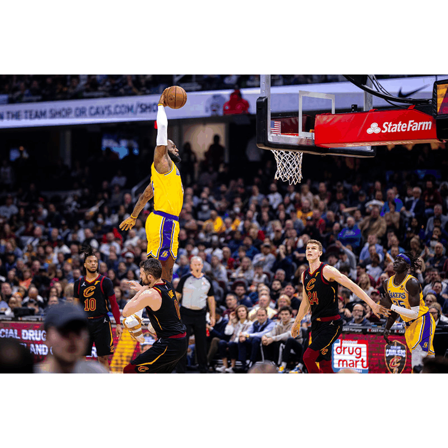
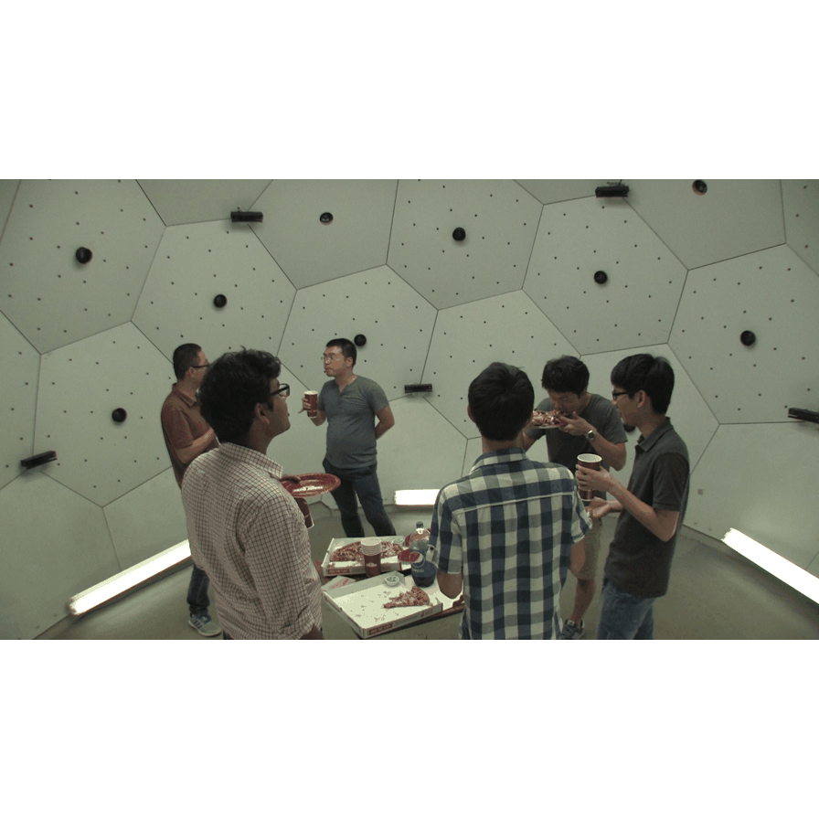

# Multi-HMR × Anny — multi-person human mesh recovery with the Anny body model, AnnyOne and 3DPW

This repository builds on **[Multi-HMR](https://github.com/naver/multi-hmr)** (Baradel et al., ECCV'24).
It moves the model from SMPL-X to the **[Anny](https://github.com/naver/anny)** parametric body model and adds:

1. **Anny training on AnnyOne.** A ViT-L *teacher* is trained on the synthetic AnnyOne dataset (~580k images), with the 88 helper bones masked and a stronger body-shape (phenotype) loss. Neck, finger and child reconstruction are still open, and the training targets carry a depth defect: see [Known defects](#known-defects).
2. **3DPW → Anny conversion.** 3DPW's SMPL ground truth is fitted to Anny so that real images can be used for training and evaluation in Anny space.
3. **Knowledge distillation.** A ViT-S *student* is distilled from the ViT-L teacher using a feature-level KL loss on backbone tokens, with teacher-initialised heads, and is trained on mixed synthetic and real data.

<div align="center">


</div>

---

## Contents
- [Repository layout](#repository-layout)
- [Status and known gaps](#status-and-known-gaps)
  - [Known defects](#known-defects)
- [Installation](#installation)
- [Quick start: demo](#quick-start-demo)
- [Student video inference and comparison](docs/video_inference.md)
- [Pipeline 1: converting 3DPW to Anny](#pipeline-1-converting-3dpw-to-anny)
- [Pipeline 2: training the ViT-L teacher](#pipeline-2-training-the-vit-l-teacher)
- [Pipeline 3: distilling the ViT-S student](#pipeline-3-distilling-the-vit-s-student)
- [Evaluation](#evaluation)
- [Results recorded so far](#results-recorded-so-far)
- [Utility scripts](#utility-scripts)
- [Running on the cluster (Slurm)](#running-on-the-cluster-slurm)
- [Upstream Multi-HMR (SMPL-X) usage](#upstream-multi-hmr-smpl-x-usage)
- [License and citation](#license-and-citation)

---

## Repository layout

```
.
├── train.py                 # training / evaluation entry point (Anny + SMPL-X, distillation, mixed data)
├── demo.py                  # inference + rendering on a folder of images
├── demo_video.py            # Student / original Multi-HMR video overlays and stability measurements
├── model.py                 # Multi-HMR model (Anny output, optional head_dim projector for students)
├── loss.py                  # training losses
├── distill.py               # knowledge-distillation loss (temperature-softmax KL on backbone tokens)
├── app.py                   # Gradio demo (HuggingFace Space)
│
├── blocks/                  # network building blocks (DINOv2 backbone, cross-attention HPH, camera embedding, SMPL layer)
├── multi_hmr_anny/          # NAVER's reference Anny Multi-HMR (used to load the official multiHMR_672_L_anny checkpoint)
├── utils/                   # camera, rendering, image, tensor and training helpers
├── datasets/                # dataloaders: annyone.py, bedlam.py, ehf.py, threedpw.py, threedpw_anny.py
│
├── scripts/
│   ├── data/                # dataset conversion and export (SMPL→Anny fitting, label building, image export)
│   ├── analysis/            # diagnostics: fit checks, shape/phenotype analysis, checkpoint inspection, montages
│   └── patches/             # historical apply_*.py patches (already applied to train.py / model.py)
│
├── slurm/
│   ├── env.sh               # shared job setup (conda, caches, cd, DINOv2 patch) — edit paths here
│   ├── train/               # current runs: teacher v9, final student v8, v10 ablation
│   ├── eval/                # evaluation jobs (AnnyOne holdout, 3DPW val/test, dataloader test)
│   ├── demo/                # demo / visual comparison jobs
│   ├── data/                # 3DPW→Anny conversion pipeline + fit check
│   └── history/             # finished runs and one-off jobs, kept unchanged as the experiment record
│
├── configs/
│   └── threedpw_tasks.txt   # 3DPW (split, sequence, person, n_frames) task list for the conversion array job
│
├── example_data/            # real photos for the demo (default --img_folder)
├── demo_images/
│   ├── 3dpw/  3dpw_random/  # 3DPW frames for demos
│   ├── annyone/             # AnnyOne holdout images (579860–579869)
│   └── annyone_fov.json     # per-image field of view for the AnnyOne demo images
│
├── threedpw_anny_full/labels/index_{train,validation,test}.txt   # index of converted 3DPW→Anny labels
│
├── results/                 # committed qualitative outputs
│   ├── demos/               # A_base, B_neckshape, C_hands, v4_restpose ablations on example_data
│   ├── anny_fit_check/      # fit diagnostics (error histograms, overlays, phenotypes)
│   └── 3dpw_to_anny_renders/{v2,v21}/   # Anny fits rendered over 3DPW frames (two converter versions)
│
├── docs/                    # investigation notes: diagnostics findings, 3DPW adapter check, Anny shape report, cluster commands
├── archive/                 # superseded code kept for reference (train_v1–v3.py, demo_original.py)
├── assets/                  # README gifs
├── requirements.txt / conda.yaml
└── LICENSE.txt / NOTICE.txt
```

**Rule of thumb.** The core Python modules live at the repo root so that `import model`, `import utils` and `import datasets.*` keep working.
Every script under `scripts/` adds the repo root to `sys.path` itself.
Always run commands **from the repo root**, for example `python scripts/data/smpl_to_anny.py …`.

---

## Status and known gaps

Read this before trying to reproduce anything.

| Gap | Impact | Fix |
|---|---|---|
| **Cluster paths.** Conda, caches and the project root are set once in `slurm/env.sh`, but job scripts still name `/netscratch/najib/...` for checkpoints, data, logs and the container image. | The scripts only run on the original cluster as-is. | Edit `slurm/env.sh`, then search-and-replace `/netscratch/najib` in the job you want to run. |
| **Checkpoints are not versioned** (`*.pt` is git-ignored). | Final teacher/student weights must be obtained separately. | Expected location: `models/multiHMR/<name>.pt`. |
| `scripts/patches/apply_*.py` are historical. | All six patches are already applied to `train.py` / `model.py`. The guard checks in the training scripts pass. | Do not re-run them. They refuse to patch twice anyway. |

### Known defects

Measured on the production teacher `anny_s2_shape_v5` (epoch 99) with the diagnostic suite in `scripts/diagnostics/`.
The evidence, the scripts and the confidence of each statement are in [`docs/diagnostics_findings.md`](docs/diagnostics_findings.md); the numbers below are copied from it.

**What is not the cause.** Ground-truth parameters decode onto the people in the images. All 16 single-joint perturbations of the body model move the intended part (pose parameters act in the bone's rest frame, forward kinematics is exact). Every active pose bone receives gradient (the 88 zero-gradient bones are exactly the masked helper bones).
No joint-mapping, rotation-convention or decoding error was demonstrated, so none of the failures below is attributed to the rig or to decoding.
The first compiled diagnostics `REPORT.md` printed "decoding defect" for check 1. That verdict came from a fixed 95% threshold that misread truncation at the image border; the rule is now truncation-aware.

| Defect | Measured | Diagnosed origin |
|---|---|---|
| **Depth** (the largest error) | On the 100-image holdout, predicted root depth = 0.33·GT + 2.36 m (≈ 0.3·GT + 2.4 m): mean 3.00 m vs 1.92 m GT, and 100% of people are placed too far. Skeletal height is right (1.405 vs 1.409 m), so the body is drawn about 35% too small (head-to-root 82 px vs 127 px). The same slope appears on training images. | Target mismatch in the code. The model anchors and reports the **head** joint (`--person_center head`, `model.py`), while `train.py prepare_gt` builds the `transl`, `dist`, heatmap-cell and offset targets at joint 0, the **root**. Pelvis-centred PVE, PA-PVE and MPJPE cannot see this (corr(PVE, depth error) = −0.03). That is why the numbers in the results table look normal while the overlays look wrong. |
| **Neck** | In-domain neck length is 99.3% of GT. Local rotation error is 62.7° (neck) and 89.5° (head), but the global head orientation error is 12.0° on the holdout and 19.9° on the hard neck poses. | Weak per-bone rotation supervision on a redundant 4-bone chain. Many decompositions give the same head pose, so the per-bone loss carries little consistent signal, which would also explain why the v4 ×4 neck boost had no measurable effect. The long-neck look in the overlays is likely the depth defect (body drawn too small, head placed where the root target pulls it) plus normal skinning. |
| **Fingers** | Finger rotation error is 17.3° as predicted and 15.1° with the fingers set to the rest pose. | Under-trained: the predictions are worse than the rest pose. Fingers get the smallest gradients of any bone group (4.7 vs 598 at the root) and the worst 6D conditioning. Perturbing a finger bone moves only that finger. The demos therefore ship with `--relax_hands 1`. |
| **Children** | The 50 youngest training people (GT age 0.015) are predicted at age 0.10 with head/height at 101% of GT. On real photos, small people come out as small adults (age 0.56–0.66, size carried by the `height` phenotype). | Representation works in-sample; generalisation fails. Only 2.53% of training people have age < 0.3 (about 11 years on Anny's scale), and the 3DPW labels pin age at 0.55 (about 20 years), so mixing in 3DPW adds no child signal. The detector-crop camera bug in `demo.py` changes placement only. |

The depth fix (build the targets at the joint the model anchors, then fine-tune briefly from epoch 99) is a separate experiment. No improvement is claimed until its holdout trace has been re-run.

**Caveats.**
- Child numbers are in-sample. The holdout contains no children, so these numbers test representation, not generalisation.
- The "hands" category of the diagnostic manifest is confounded by truncation. Its people fill the frame (63% of joints inside the image), so its PVE (156.8 mm) measures truncation and depth, not hands.
- The 51.8 mm PVE from the capped overfit run is an optimisation check on 40 memorised training images. It is not a validation number. In the same run, the holdout PVE rose from 87.6 to 127.2 mm.

**Future work (not measured).** A global head-orientation loss for the neck chain (`--alpha_global_rot`), and a region-normalised rotation loss for the fingers. The implemented change is `--rotmat_region_norm`: it gives the hands region one third of the rotation loss, down from its ~40% bone share, so it is not an upweighting of the finger bones and a null result there says nothing about upweighting.

The flag-gated experiments for the four defects are described in [`docs/experiments_plan.md`](docs/experiments_plan.md) and implemented in [`slurm/experiments/`](slurm/experiments/). Nothing from them has been measured yet.

---

## Installation

Tested with Python 3.9, CUDA 12.1 and torch 2.0.1.

```bash
# venv
python3.9 -m venv .multihmr && source .multihmr/bin/activate
pip install -r requirements.txt          # includes the `anny` package

# or conda
conda env create -f conda.yaml && conda activate multihmr
```

Extra setup:
- **DINOv2 on Python 3.9.** The torch-hub DINOv2 code uses `X | None` type hints, which Python 3.9 rejects. Every Slurm script patches it like this:
  ```bash
  python -c "import torch; torch.hub.load('facebookresearch/dinov2','dinov2_vitl14',pretrained=False)" || true
  find $TORCH_HOME/hub/facebookresearch_dinov2_main/dinov2 -name "*.py" -exec sed -i 's/ | None//g' {} +
  ```
- **Headless rendering.** Set `PYOPENGL_PLATFORM=egl` (and `EGL_DEVICE_ID=0`).
- **Anny cache.** Anny writes to `~/.cache/anny`. On quota-limited homes, symlink it to scratch space (the Slurm scripts already do this).
- **SMPL models.** These are needed for 3DPW conversion and evaluation: `models/smpl/SMPL_NEUTRAL.pkl` (plus MALE/FEMALE for upstream 3DPW eval) and `models/smplx/SMPLX_NEUTRAL.npz`.

---

## Quick start: demo

The official NAVER Anny checkpoint downloads automatically to `$HOME/models/multiHMR`:

```bash
python3.9 demo.py \
    --img_folder example_data \
    --out_folder demo_out \
    --model_name multiHMR_672_L_anny \
    --save_mesh 1
```

To run one of the checkpoints trained here, put it in the checkpoint cache as `<name>.pt` and pass `--model_name <name>`.
`slurm/demo/run_demo*.sh` copies `logs/anny_model/<run>/checkpoints/<epoch>.pt` into that cache for you.

Recommended flags depend on the input domain (see `slurm/demo/run_demo.sh` for the reasoning behind each one):

| Flag | Real photos (out of domain) | AnnyOne / synthetic (in domain) |
|---|---|---|
| `--use_person_detector` | `1` (Faster R-CNN-guided crops, `--detector_thresh 0.8 --crop_margin 0.35 --anchor_to_box 1`) | `0` |
| `--det_thresh` | `0.15` | `0.3` |
| `--fov` / `--fov_json` | `--fov 55` | `--fov_json demo_images/annyone_fov.json` (per-image FOV) |
| `--mask_helper_joints 1` | ✔ forces the 88 untrained helper bones to identity (the V1 evaluation setting) | ✔ |
| `--relax_hands 1` | ✔ sets the finger poses to the rest pose (see below) | ✔ |

**Finger poses in the demo renders are the rest pose, not predictions.**
Every `slurm/demo/run_demo*.sh` passes `--relax_hands 1`, which sets the finger and thumb phalanges to identity.
This is deliberate: the predicted fingers are worse than the rest pose (rotation error 17.3° vs 15.1° on the AnnyOne holdout; see [Known defects](#known-defects)).

Do **not** use `--neutral_phenotypes`.
Measured against AnnyOne ground truth, forcing phenotypes to 0.5 moved them *away* from the truth and made necks worse (see `docs/anny_shape_report.txt` and the comments in `run_demo.sh`).

Side-by-side comparison of several models: `slurm/demo/run_demo_compare.sh`, then `scripts/analysis/make_montage.py`.

---

## Pipeline 1: converting 3DPW to Anny

3DPW provides SMPL parameters. The steps below fit Anny to each tracked person and export per-image labels in AnnyOne format, so that 3DPW can be mixed into training (`--mix_3dpw_labels`) and used for evaluation in Anny space.

| Step | Slurm job | Script | Output |
|---|---|---|---|
| 1. Extract 3DPW and list tasks | `slurm/data/run_3dpw_list.sh` | – | `data/3DPW/`, `configs/threedpw_tasks.txt` (one line per split/seq/person/n_frames) |
| 2. Fit SMPL → Anny (array job, `%8` in parallel) | `slurm/data/run_smpl_to_anny_task.sh` | `scripts/data/smpl_to_anny.py` (v2.2) | `threedpw_anny_full/<split>/<seq>_p<person>.npz` |
| 3. Build per-image labels (CPU, ~1 min) | `slurm/data/run_build_labels.sh` | `scripts/data/build_threedpw_anny_labels.py` | `threedpw_anny_full/labels/<split>/<seq>/image_NNNNN.pkl` and `labels/index_<split>.txt` |

```bash
sbatch slurm/data/run_3dpw_list.sh
N=$(wc -l < configs/threedpw_tasks.txt)
sbatch --array=0-$((N-1))%8 slurm/data/run_smpl_to_anny_task.sh
sbatch slurm/data/run_build_labels.sh
```

**How the fit works (`smpl_to_anny.py`).**
- Gradient descent fits Anny pose and shape to 3DPW `jointPositions`.
- Frames are sampled with stride 3: a cold start for the first frame, warm starts afterwards, then a refinement pass.
- One shape is shared per person. Only the `height` and `proportions` phenotypes are free; `age` is fixed at 0.55.
- Each frame also stores the mesh bbox and the visible fraction.

The camera convention `X_cam = R·X_world + t` was checked against the OpenPose 2D keypoints (8.9 px mean reprojection error); see `docs/3dpw_adapter_check.md`.

**Quality checks.**
- `scripts/analysis/check_anny_fit.py`: rotation validity, joint-error histogram, phenotype consistency, skeleton overlays and a mirror test. Job: `slurm/data/run_check_anny_fit.sh`. Output: `results/anny_fit_check/`.
- `scripts/analysis/render_anny_fit.py`: overlays the fitted meshes on 3DPW frames. Output: `results/3dpw_to_anny_renders/`.

**Earlier pilots, kept for reference.**
- `run_smpl_to_anny.sh` and `run_smpl_to_anny_scenes{,_v21}.sh`: 4-scene pilots with v2 and v2.1 of the converter.
- `scripts/data/smpl_to_anny_v3_frozen.py`: an experimental variant with a frozen-shape second pass.
- `scripts/data/npz_to_annyone.py` (+ `run_npz_to_annyone.sh`): the first single-sequence adapter, which `build_threedpw_anny_labels.py` replaced.

Current label set: **4,451 train / 2,458 validation / 9,722 test** images.

---

## Pipeline 2: training the ViT-L teacher

All runs start from NAVER's `multiHMR_672_L_anny.pt` backbone (`--pretrained_remap 1 --load_only_backbone 1`) at 672 px on AnnyOne, unless noted.
Each training script is the full, self-documenting record of a run. Its header explains the reasoning and quotes the previous run's numbers.
Scripts of finished runs live in `slurm/history/` (unchanged); the runs still in use are in `slurm/train/`.

| Order | Script | Run name | Idea |
|---|---|---|---|
| 0 | `train_anny_test.sh` → `train_anny.sh` → `train_anny_medium.sh` | anny_small_run → anny_full_run_v1/v2 | Smoke test, then first full AnnyOne runs; 2D losses from epoch 20 |
| 1 | `train_step1_pretrained_bb.sh` (+ `_resume`) | anny_s1_pretrained_bb_v2 | Pretrained backbone + fresh heads, full fine-tune |
| 2 | `train_step2_frozen_bb.sh` (+ `_resume`) | anny_s2_frozen_bb_v2 | Same with the backbone frozen (epoch 299 is the step-2 result) |
| 3 | `train_s2_partialft.sh` | anny_s2_partialft_v3 | Unfreeze the last 4 blocks + mask the 88 helper joints |
| 4 | `train_s2_boosted_v4.sh` | anny_s2_boosted_v4 | ×4 loss weight on neck/hand bones (no visible gain) |
| 5 | `train_s2_shape_v5.sh` | **anny_s2_shape_v5** | `--alpha_shape 20` fixes the age/height bias. **Teacher for distillation v1–v7** (epoch 99) |
| – | `train_v7_scratch.sh`, `train_v8_partial_freeze.sh` (+ `train_v8_resume.sh`) | anny_v7_scratch, anny_partial_freeze | Clean re-runs from the base with all fixes (ablations) |
| 6 | `train_teacher_v9_mixed.sh` | **anny_teacher_v9_mixed** | v5 recipe + 30% real 3DPW-train, evaluated on 3DPW-val. **Teacher for the final student** (epoch 62) |
| – | `train_v10_scratch_mixed.sh` | anny_v10_scratch_mixed | Ablation: mixed data from the start |

Key flags introduced along the way:
- `--mask_helper_joints_train 1`
- `--alpha_shape 20`
- `--use_anny_shape 1`
- `--person_center head`
- `--mix_3dpw_labels <dir> --mix_3dpw_ratio 0.3 --mix_3dpw_split train`
- `--val_3dpw_split validation --val_3dpw_n 300`
- `--tf32 1`

---

## Pipeline 3: distilling the ViT-S student

Student: `dinov2_vits14` (384-d). Teacher: frozen ViT-L (1024-d).

**Loss (`distill.py`).**
- KL divergence between temperature-softmaxed backbone patch tokens (`--lambda_kd`, `--kd_temperature 4`, softmax over channels), scaled by T².
- A learnable projector maps the student's 384-d tokens to the teacher's 1024 dimensions.
- An optional output-level L1 term against the teacher's predictions (`--lambda_kd_out`).

**Run lineage (each run motivated by the previous run's failure mode):**

| Run | Script | Change | Recorded result |
|---|---|---|---|
| v1 | `train_distill_vits.sh` | Feature KL only, ImageNet DINOv2 init | Sanity check |
| v2 | `train_distill_vits_v2.sh` | Lower LR, slower decay | PVE 193.4 (teacher 73.6) |
| v3 | `train_distill_vits_v3.sh` | `--init_heads_from_teacher 1`, `--lambda_kd_out 1` | Worse: only the head *input* layers fail to transfer |
| v4 | `train_distill_vits_v4.sh` | Init from `multiHMR_672_S`, colour jitter | 156 / 117 |
| v5 | `train_distill_vits_v5.sh` | `--freeze_heads_epochs 5` | 159 / 113 |
| v6 | `train_distill_vits_v6.sh` | **`--head_dim 1024`**: projector before the heads, so all 67/67 head tensors transfer | 152 / 105 |
| v6b → v6c | `train_distill_vits_v6b.sh`, `_v6c.sh` | Continue training; `--teacher_bf16`, batch 16 | **114.5 / 84.6** on the AnnyOne holdout (best synthetic-only) |
| v7 | `train_distill_vits_v7_mixed.sh` | + 30% real 3DPW | **3DPW-val 107.0 / 77.1**; holdout 120.1 / 89.4 |
| **v8 (final)** | `train_distill_vits_v8_final.sh` | v6c weights + v7 mixed data at batch 16, teacher v9 | 3DPW-test is evaluated once at the end |

Numbers are PVE / PA-PVE in mm, copied from the script headers.
They come from `train.py evaluate()`, which does not mask the helper bones (V0, see [Results recorded so far](#results-recorded-so-far)).

The student flags (`--init_heads_from_teacher`, `--freeze_heads_epochs`, `--head_dim`, `--teacher_bf16`, `--mix_3dpw_*`) came from the patches in `scripts/patches/`.
Those patches are already applied, so the flags exist in `train.py`.

```bash
sbatch slurm/train/train_distill_vits_v8_final.sh
```

---

## Evaluation

| Job | What it does |
|---|---|
| `slurm/eval/run_eval_3dpw.sh` | Student on 3DPW-validation (Anny labels) |
| `slurm/eval/run_eval_3dpw_teacher.sh` | Teacher on 3DPW-validation |
| `slurm/eval/run_eval_3dpw_test.sh` | **3DPW-test: run once, at the end** |
| `slurm/history/run_eval_test.sh` | Legacy AnnyOne evaluation through `archive/train_v3.py` |
| `slurm/eval/run_test.sh` | Dataloader smoke test (`scripts/analysis/test_loader.py`) |

Evaluation goes through `train.py --eval_only 1`.
The AnnyOne holdout (`--val_anny_n`) and 3DPW (`--val_3dpw_split`, `--val_3dpw_n`) are evaluated every `--eval_freq` epochs during training.

---

## Results recorded so far

| Model | Backbone | AnnyOne holdout PVE / PA-PVE | 3DPW-val PVE / PA-PVE |
|---|---|---|---|
| **Teacher anny_s2_shape_v5 (epoch 99), V1: helper bones masked, as in the demos** | ViT-L | **70.5 / 53.3** (recall 90.2%) | – |
| Teacher anny_s2_shape_v5 (epoch 99), V0: `train.py evaluate()`, helper bones unmasked (the 74 mm quoted in the thesis) | ViT-L | 73.6–74.3 / – | 127.1 / – |
| Student v6c | ViT-S | 114.5 / 84.6 | – |
| Student v7 (mixed) | ViT-S | 120.1 / 89.4 | 107.0 / 77.1 |
| Teacher v9 (mixed), student v8 final | ViT-L / ViT-S | *not yet recorded* | *not yet recorded* |

**V1 is the headline.**
`train.py evaluate()` reports 74.3 mm because it does not mask the 88 helper bones, while every demo masks them: on the people matched under both settings, unmasked vs masked is +3.8 mm PVE (paired).
The thesis's 74 mm is therefore 70.5 mm under the settings the demos use.
V1 comes from `scripts/diagnostics/diag_holdout_trace.py` on the 100 holdout images that `--val_anny_n 100` reserves (indices 579860–579959), the images `train.py` evaluates on during training.
The student rows and the 3DPW column were also measured with `train.py evaluate()`, so they are unmasked: compare them with the V0 row, not with the V1 headline.
All of these metrics are pelvis-centred and do not see the depth defect described in [Known defects](#known-defects).

Qualitative ablations on real photos are in `results/demos/`:
- `A_base`: baseline.
- `B_neckshape`: neck/shape flags tried at the time (historical; the neck is not fixed, see [Known defects](#known-defects)).
- `C_hands`: hand relaxation (`--relax_hands 1`).
- `v4_restpose`: rest-pose check. A long neck that persisted in these renders was read as a body-model property; the diagnostics do not support that reading (in-domain neck length is within 1% of GT, and the body-model probe passes).

---

## Utility scripts

**`scripts/data/`**
| Script | Purpose |
|---|---|
| `smpl_to_anny.py` | SMPL → Anny fitter for 3DPW (v2.2) |
| `smpl_to_anny_v3_frozen.py` | Experimental fitter variant (SMPL forward first, per-bone weights, frozen-shape second pass) |
| `build_threedpw_anny_labels.py` | Fits → per-image AnnyOne-format labels + split index |
| `npz_to_annyone.py` | Earlier single-sequence fit → label adapter |
| `anyone_image_export.py` | Export AnnyOne images + `annyone_fov.json` |
| `threedpw_image_export.py` | Export 3DPW images + a per-image FOV map |
| `sample_images.py` | Sample 3DPW frames across sequences into a flat demo folder |

**`scripts/analysis/`**
| Script | Purpose |
|---|---|
| `check_anny_fit.py` | Sanity report on a fit `.npz` |
| `render_anny_fit.py` | Render fitted meshes over 3DPW frames |
| `compare_gt_pred_shape.py` | GT vs predicted phenotypes on AnnyOne holdout samples (neck investigation) |
| `phenotype_stats.py` | GT phenotype distribution of AnnyOne |
| `check_mask_boost.py` | Check whether boosted neck/hand bones overlap the masked helper bones |
| `check_shape.py`, `explore_anny.py` | Inspect raw AnnyOne samples, collated batches and phenotype labels |
| `inspect_ckpt.py` | Which model class a checkpoint's keys match (catches silent `strict=False` no-loads) |
| `inspect_prefix.py` | Dump the key tree under a checkpoint prefix |
| `make_montage.py` | Side-by-side montage of demo outputs from several models |
| `test_loader.py` | AnnyOne DataLoader smoke test |

**`scripts/patches/`** (already applied; listed in the order they were applied)
1. `apply_student_fix.py`: `--init_heads_from_teacher`, `--lambda_kd_out`.
2. `apply_student_fix_v2.py`: `--freeze_heads_epochs`.
3. `apply_student_fix_v3.py`: `--head_dim` projector (model.py + train.py).
4. `apply_speed_fix.py`: `--tf32`, `--teacher_bf16`, loader pinning.
5. `apply_mixed_data_fix.py`: `--mix_3dpw_*`, `--val_3dpw_*`.
6. `apply_mixed_data_fix_v2.py`: 3DPW loader in `--eval_only`.

---

## Running on the cluster (Slurm)

Each script in `slurm/` is a standalone `sbatch` job that runs one command inside an enroot container.
The setup every job needs (conda, cache directories, the `~/.cache/anny` redirect, thread limits, `cd` to the project root, the DINOv2 Python 3.9 patch) lives in **`slurm/env.sh`**; active jobs start with `source /netscratch/najib/multi-hmr/slurm/env.sh`.
Scripts in `slurm/history/` predate `env.sh` and still carry their own copy of that setup.

Submit jobs from the repo root so that relative `logs/` paths resolve:

```bash
mkdir -p logs
sbatch slurm/train/train_teacher_v9_mixed.sh
sbatch slurm/demo/run_demo.sh
```

Checkpoints are written to `logs/anny_model/<run>/checkpoints/<epoch>.pt`, and only the 10 most recent are kept.
**Copy the final checkpoint to `models/multiHMR/<run>_<epoch>.pt` before launching anything that resumes from it.**
`docs/cluster_commands.txt` contains example copy commands.

---

## Upstream Multi-HMR (SMPL-X) usage

The original SMPL-X functionality is unchanged:
- BEDLAM, EHF and 3DPW preprocessing.
- `train.py --train_data BEDLAM`.
- The official checkpoints (`multiHMR_896_L`, `multiHMR_672_{L,B,S}`, `multiHMR_672_L_anny`, …).

See the [upstream README](https://github.com/naver/multi-hmr#readme) for dataset preparation, the checkpoint table and the CUFFS dataset.

---

## License and citation

Code and checkpoints follow the terms of [LICENSE](LICENSE.txt) and [NOTICE](NOTICE.txt) (NAVER Multi-HMR).
The Anny checkpoint has its own [license](https://download.europe.naverlabs.com/ComputerVision/MultiHMR/Checkpoint_License_Anny.txt).
AnnyOne, 3DPW, SMPL and SMPL-X are each subject to their own licenses.

```bibtex
@inproceedings{multi-hmr2024,
    title={Multi-HMR: Multi-Person Whole-Body Human Mesh Recovery in a Single Shot},
    author={Baradel*, Fabien and Armando, Matthieu and Galaaoui, Salma and
            Br{\'e}gier, Romain and Weinzaepfel, Philippe and Rogez, Gr{\'e}gory and Lucas*, Thomas},
    booktitle={ECCV},
    year={2024}
}
```
